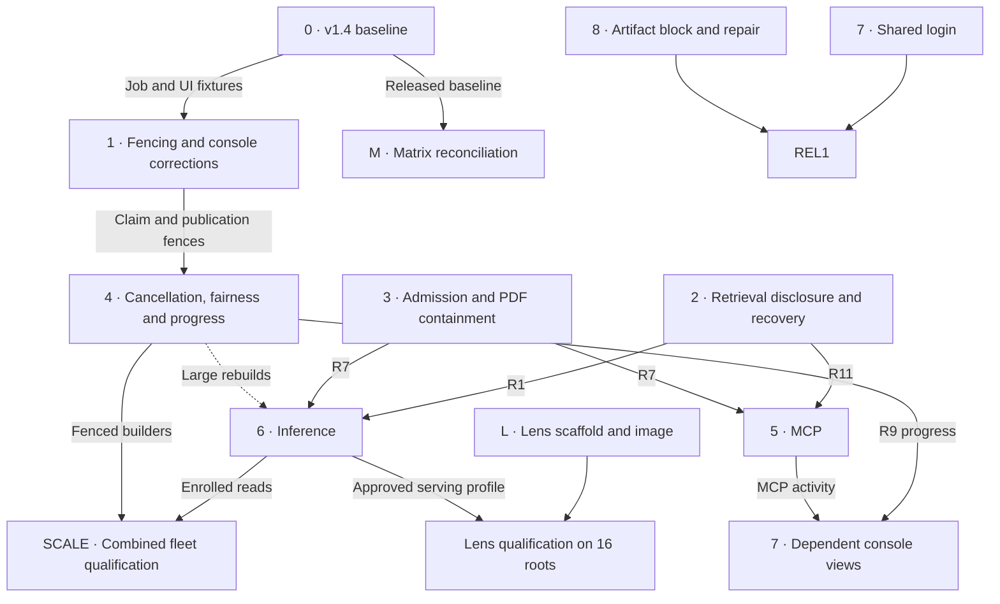

# Munarium Server v1.5 “ClearView” implementation plan

## Implementation status

The [implementation ledger](implementation-ledger.md) tracks each planned task by ID, links its governing design and records progress and outstanding evidence.
The [128 GB workstation handoff](handoff-128.md) pins the transfer commits and records where to resume qualification.

- **Matrix handoff.** Matrix [PR #4](https://github.com/iokaio/munarium-matrix/pull/4) adds the compatibility profile, transfer inventory and interoperability checks. Local parity passed for all ten legacy CLI verbs, and 11 live worker tests passed against the published v1.4.0 Server image. Server cutover and source removal still require the [M1 receipts](implementation-ledger.md#phase-m-matrix-isolation).
- **Lens.** The CPU scaffold and opt-in Candle serving implementation are in the Lens repository. The Server's local I3 pilot used both Qwen3 stages. Held-out qualification of the embedding-only candidate, model capacity bounds and the 16-root workspace exercise remain open. [Lens milestones](implementation-ledger.md#phase-l-lens-delivery)
- **Server implementation.** The 21 November follow-ups freeze the isolated PDF profile, classify its deferred failure, expose R11 in Rust, use exact PostgreSQL hash retrieval for pinned and restored reads, and enforce fleet-wide MCP policy agreement with measured token settlement. See the [dated ledger entry](implementation-ledger.md#21-november-2026-implementation) for evidence and remaining release work.
- **Local qualification.** Both real MCP client revisions, a v1.4 PostgreSQL backup restore, console cutover and rollback, S3 generation-aware repair, and the Server's CPU Lens probes passed locally. The [rehearsal record](implementation-ledger.md#21-november-local-qualification-rehearsals) identifies the inputs and the release evidence still due.
- **PR size.** The 500-line review trigger (more than 500 added plus deleted non-generated lines: split by behavior or explain in the [PR template](../../../.github/pull_request_template.md)) is **suspended for the ClearView feature work** by maintainer decision of 20 November 2026. The general rule in the contributor instructions still applies to all other work; a ClearView PR still states its size and excluded generated artifacts.

Phase 1 starts with the [v1.4 job and console fixtures](../../tests/fixtures/clearview-phase1/README.md). Phase 3 starts with the [inventory of routes, permits and extractors](phase3-inventory.md). The [delivery phases](#delivery-phases) give the entry conditions for implementation. Shared wire changes also require a recorded hub decision and an exported contract.

ClearView preserves existing clients, indexes, runbooks and operator defaults on upgrade. It delivers the Matrix handoff, Lens, governed MCP tools, operator-controlled scale-out, revocable console sessions and fleet-wide artifact protection. All must qualify on the v1.5 candidate. Operators choose when to enroll collections in Lens, enable MCP or switch console login. [Release evidence](#release-evidence)

**Later scope.** MCP streaming, ingestion over MCP, governed-memory tools, IR-5 context packing, IR-6 in-process inference, bundling model weights or a local generation runtime with Server, and automatic scaling are deferred. Operators can use an explicitly configured generative provider and can add Server capacity with Lens disabled.

## Design owners

| Owner document | What to implement from it |
|---|---|
| [Server retrieval, builds and console](airk-analysis.md) | Runtime work R1–R12, inference integration IR-0–IR-4 and console work U1–U14. AIRK observations give the rationale. |
| [MCP endpoint](mcp-analysis.md) | The eleven tools, two protocol revisions, budgets, audit and client qualification. |
| [Matrix and Lens handoffs](repository-handoffs.md) | Matrix reconciliation and removal, Lens repository foundation, corpus inventory, qualification and worker placement. |
| [Matrix switch receipts](matrix-switch-receipts.md) | M1 step 3: the pinned Matrix consumer export, M1-T1 results, the M1-T2 procedure and the Server CI pin check. |
| [Scaling Server and Lens](scale-out.md) | Server chart and diagnostics, independently sized worker groups, bottlenecks and controlled scale-out under load. |

The [decision register](#decision-register) links each rule to its normative home. Cite the test ID from that home in a release receipt. The register and phase table are summaries. Product decisions apply to v1.5 implementation. Cross-project wire changes still need the hub decision, contract export and consumer re-vendoring process.

## Source baselines

| Repository or study | Inspected revision and purpose |
|---|---|
| Munarium Server, CLI and four SDKs | Published `v1.4.0` and `clients-v1.4.0` at `25012c22087fbaa8ce29ddd68d2880d6e9499b1c`. Use the released artifacts for upgrade, downgrade and wire fixtures. [Release record](../guides/server-1.4.md) · [SDK policy](../../../clients/compatibility.json) |
| Munarium implementation | `bb18085f3d407e9b77d551fbf7ac68a6572fce27` underlies the AIRK and MCP comparisons. Preserve later retained-action custody recovery when testing against the release. |
| Munarium and Matrix reconciliation | Munarium main baseline `bb18085f3d407e9b77d551fbf7ac68a6572fce27` and Matrix `643863fcb4433c8236f3ab22ca812f17c354f34c`, compared with the published v1.4 tree. The inspected design branch had the same Matrix inputs as this main revision. Refresh both heads and record the actual transfer revisions at implementation. [Reconciliation procedure](repository-handoffs.md#reconcile-the-existing-matrix-repository) |
| Lens foundation | `528dc3e41970e70fca77f2a9d2b8f0f0088c1f68` is the inspected starter. The CPU stub is verified at `8cf7f040c06bd215cb536b9e06ec3e8f3415bdfb`. Freeze the eventual tested image and source revision for release. |
| AIRK comparison source | `55eebc96` (1.8.207) for the runtime comparison and `f200897c` for inference and console observations. Paths and symbols refer to those snapshots. [Method and access limits](airk-analysis.md#2-method-and-limits) |

## v1.4 compatibility

| Surface | v1.5 obligation | Qualification case |
|---|---|---|
| **COMPAT-T1** · REST, typed gRPC, native bridge and SSE | Keep paths, methods, protobuf tags, DTO types, errors, pagination and terminal events. Omitted options retain v1.4 meaning. New records use optional fields or an explicitly requested profile. | Replay success, refusal, conflict and streaming cases through both binaries. Check absent/null/empty distinctions and old strict enum readers. Compare deterministic bytes where promised and compare meaning for generated IDs and timestamps. |
| **COMPAT-T2** · CLI, SDKs and configuration | Existing scripts, runbooks, tokens, Helm values and environment settings retain their effect, including on Matrix-enabled installations. | Run the released Rust, Python, .NET and Java 1.4 clients and CLI against the candidate, and candidate clients' 1.4 operations against 1.4. Include existing Matrix command output and exit codes. Upgrade a v1.4 chart with its original values, then exercise explicit replica-count migration and rollback. [SCALE-1-T1](scale-out.md#scale-1-t1) |
| **COMPAT-T3** · Stored state and artifacts | Use additive migrations. Keep old indexes, hashes, approvals, provenance, session pins, evidence IDs and past contracts readable. Preserve the supported embedded datastore consumer. Binary rollback across the v1.5 migrations is by backup restore (amended by maintainer decision of 20 November 2026): take a backup before upgrading; rolling back restores that pre-upgrade backup into v1.4.0, and data written by v1.5 after the upgrade is lost. [Upgrade and rollback](../guides/server-1.5.md#rolling-back-to-140) | Seed a disposable PostgreSQL cell and object store using 1.4, including sealed evidence and a pinned session. Take and verify a backup, upgrade in place, read and write with the upgraded fleet, then stop v1.5, restore the pre-upgrade backup into v1.4.0 and re-read. Confirm that v1.4.0 refuses the upgraded database (`VersionMissing`) as a negative control. Exercise the documented memory-store surface separately. |
| **COMPAT-T4** · Optional work and cost | Installation alone never enables MCP, model downloads, inference calls, paid OCR escalation, shadow work or corpus rebuilds. Existing provider settings and policies continue to operate. | With no new settings, run local-hash retrieval, existing provider configurations, legacy PDF ingestion and configured/unconfigured Matrix cases. Count outbound calls and compare old index identities and ordering. |
| **COMPAT-T5** · Operator interface | Retain existing URLs and supported login and management workflows through rollout. Make failed reads distinct from empty results and review destructive console actions. | Exercise bookmarks, CSRF, view-only mode and automation through the supported API. Qualify mixed-replica sessions before changing the login default. |

A v1.5 client must obtain positive capability evidence before relying on a field a v1.4 binary might ignore. Keep old indexes, grants and policies usable during rollout. Activate new semantics only after the relevant readers, writers and builders support them. For each activation, document the last point for binary rollback and how to restore or recover any new state. Returning to a v1.4.0 binary after the v1.5 migrations is by pre-upgrade backup restore ([COMPAT-T3](#compat-t3)). The Server image remains static musl. Keep HTTP, provider and storage dependencies outside the kernel. [Wire compatibility](../wire-compatibility.md)

## Delivery phases

Work can proceed in parallel as each row's entry conditions clear. The component owner records outstanding prerequisites and the next decision or measurement in the Phase 0 worklist. The release owner collects final results on the exact release candidate.

| Phase | Deliverable | May begin when | Done when |
|---|---|---|---|
| 0 | Server release engineering freezes the v1.4 baseline, scope and contract worklist. | Immediately. | **P0-T1** records released digests, fixtures, expected results, accountable components and rollback boundaries. For each pending contract or measurement, name the owner, affected phase and next review date. An affected wire change waits for its hub record and export. [Baseline record](v14-baseline.md) |
| M | Reconcile and improve Matrix in its existing repo, then delete superseded files in main. | Both Git trees and the published baseline are pinned. | Each removed path has a verified destination. Real-peer, CLI, container, contract and docs parity pass. [M1](repository-handoffs.md#m1) |
| L | Build the Lens repo, qualified image and operator docs. | The scaffold can start immediately. Production serving needs IR-0–IR-4. | A fresh checkout builds the stub. The completed image also passes both corpus-family thresholds and every workspace build/query/citation/rollback receipt. [Lens delivery](repository-handoffs.md#lens-d1) |
| 1 | Fence job claims and publication, recover exhausted jobs, classify failures and correct misleading console output (R4, R5, U5, U9). | v1.4 job and UI fixtures exist. R5's wire shape requires C2. | A retired claimant cannot authorize another write. Recovery can finish an immutable write authorized before reclaim. An expired final attempt releases its target and reports a classified failure. Historical failures serialize correctly and an unavailable read is visible in the console. [R4-T1](airk-analysis.md#r4-t1) · [C2-T1](airk-analysis.md#c2-t1) |
| 2 | Explain retrieval, coverage gaps and recovery (R1, R2, R11). | Shared response semantics recorded. | REST and gRPC pass legacy and opted-in cases, including missing required evidence and recovery for an uncertain command. [C1](airk-analysis.md#c1) · [Recovery guide](../ops/command-recovery.md) |
| 3 | Bound heavy requests and PDF extraction (R7, R3). | Routes, current permits and extractor identities inventoried. | Authenticated control operations work at saturation and the child exits and releases resources on failure. [B3](airk-analysis.md#b3) · [B4](airk-analysis.md#b4) |
| 4 | Cooperative cancellation, fair claiming, fenced progress and validated IDs (R6, R8, R9, R12). | Phase 1 claim fencing works. | A replacement can finish after the cancelled worker dies. Recovery identifies which versions published and excludes stale writes. Multi-builder fairness, progress history and the v1.4 queue default pass. [R6-T1](airk-analysis.md#r6-t1) · [B1](airk-analysis.md#b1) · [B2](airk-analysis.md#b2) |
| 5 | Implement the complete opt-in MCP endpoint. | R7 admission, R11 recovery and the required shared authority contracts are available. | The exact candidate passes the eleven-tool suite, both real-client runs, evidence, spend, audit and native rollback checks. [MCP release criteria](mcp-analysis.md#a5) |
| 6 | Integrate optional semantic indexing and reranking (IR-0–IR-4). | R1 disclosure and R7 admission available. Use phase 4 for large rebuilds. | The approved profile serves enrolled collections, handles outage policy and restores the prior approved index. Hash-only installations retain v1.4 behavior. [I1](airk-analysis.md#i1) · [I3](airk-analysis.md#i3) |
| SCALE | Align chart and runtime counts (SCALE-1), separate builders (SCALE-2), expose pool and backlog diagnostics (SCALE-3). | Server-only work starts from the v1.4 chart. Fenced multi-builder claims need phase 4. Lens tests need a qualified serving profile. | Hash-only Server and combined Server/Lens deployments pass operator resize and drain under load. Shared and dedicated pools pass placement and isolation checks. [SC1 and work packages](scale-out.md#sc1) · [SC2 placement tests](repository-handoffs.md#sc2) |
| 7 | Improve the server-rendered console (U1–U14), including reviewed actions and the new login. | U5 and U9 start with Phase 1 fixtures. Navigation and page work can proceed independently. U10 needs the shared session design, U12 needs R9 and MCP views need Phase 5. | Existing bookmarks, roles, confirmation and keyboard flows pass. Login cutover, sign-out, expiry and rollback pass across replicas. [Console sequence](airk-analysis.md#98-suggested-order) · [LOGIN1](airk-analysis.md#login1) |
| 8 | Isolate damaged copies, confirm fleet blocks and clear verified repairs (R10). | Verifier identities, storage pins and durable finding records are defined. Proposed in [artifact damage](artifact-damage.md), pending the ART1/ART2 hub records. | Warm and restarted readers honor the block. Results and stream events from an in-flight read require release authorization before the block commits. Unauthorized, stale or unverified repairs cannot clear it. [ART1](airk-analysis.md#art1) · [ART2](airk-analysis.md#art2) |

### Cross-repository sequencing and critical path

- **Matrix.** First reconcile the released behavior with both current trees, preserve newer destination work, and qualify the replacement from an isolated source checkout and packaged image. Remove a Matrix-owned source or manual from main only when its matching receipt passes. [Transfer sequence](repository-handoffs.md#matrix-ownership-and-the-v14-boundary)
- **Lens and scale-out.** Write the buildable CPU stub, design pages, source and open-source contributor artifacts in Lens first. The longest dependent sequence is likely to be authorized corpus freeze → model and hardware qualification → approved semantic indexes → per-file citation and rollback checks across all 16 repos. Start environment sizing and access checks with the scaffold. Server-only scaling can proceed independently. [Lens foundation](repository-handoffs.md#lens-foundation-lens-0) · [Scaling qualification](scale-out.md#qualification-and-rollback)
- **MCP.** The evidence scope, interrupted-call recovery, durable admission and accounting contracts gate the affected tools. Arrange a real-client run for each required protocol revision early enough to exercise discovery, authorization and reconnect on the final build. A missing client receipt blocks the whole release. [Endpoint qualification](mcp-analysis.md#a5)
- **Console and artifact recovery.** Reuse a multi-replica qualification environment, but collect independent proofs for login cutover and corruption confirmation/repair. In particular, a single verifier running twice does not establish fleet corruption. [Release decision](#rel1)

## Release evidence

Use one receipt per acceptance ID and environment. Record candidate and baseline digests, configuration, fixture or inventory revision, expected and observed results, coverage gaps, owner and evidence location. A missing or failed required receipt holds v1.5, including for features that default off. By maintainer decision of 20 November 2026, cosign signature verification and a real-browser accessibility pass are **not required** release evidence for v1.5.

Local rehearsal receipts for COMPAT-T1 to T5 and A5-T2, collected on one workstation against the published v1.4.0 image and a local candidate build, are in [compat-local-receipts.md](compat-local-receipts.md). They are `evidence_class: local` and do not replace the receipts above on the exact release candidate.

| Required on the v1.5 candidate | Evidence the release owner collects |
|---|---|
| [COMPAT-T1 through T5](#v14-compatibility) and [Server validation](../guides/validation.md) | Replay both client directions, mixed replicas and in-place rollback on standalone and Matrix-enabled installations. Collect the applicable build, database, cluster, client conformance, contract and documentation results. |
| [M1](repository-handoffs.md#m1) | Verify the Matrix export, standalone build, real peer and CLI before removing each superseded path. |
| [LENS-D1](repository-handoffs.md#lens-d1), [I3](airk-analysis.md#i3) and [LENS-D2](repository-handoffs.md#lens-d2) | Pin the Lens image to the tested Server candidate. Documentation and code each pass their thresholds. All 16 roots have build, query, resolved citation and rollback receipts, including the authorized receipt for the restricted root. |
| [SCALE and SC1](scale-out.md#sc1), [SC2](repository-handoffs.md#sc2) | Exercise Server resize and drain with Lens off, then with enrolled collections. Verify placement and isolation on shared and dedicated pools. |
| [A5](mcp-analysis.md#a5) | Exercise all eleven MCP tools and collect a real-client transcript for each protocol revision. Qualify authorized recovery after a lost reply, spending and the default-off upgrade. |
| [REL1](#rel1) | Collect both LOGIN1 and ART1/ART2 on the same candidate, including cutover, repair and rollback. |

**Maintenance releases.** A separately qualified v1.4.x candidate can carry an independently compatible fix such as claim fencing or sanitizing a stored job error on read. Check the v1.4 clients, stored rows, mixed-version builders and rollback paths affected by that fix. A new wire field follows its shared contract process. Re-run the applicable receipts on the v1.5 candidate that includes the fix. Record the qualified scope, defaults and rollback cutoffs in the applicable release guide. [Release documentation](../README.md)

**REL1.** Server v1.5 waits for **both** the cross-replica console login and the durable fleet-wide artifact block. **REL1-T1** passes when the exact candidate has the LOGIN1 cutover/rollback and ART1/ART2 isolation, block and repair receipts. Hold release if either feature lacks passing evidence. [Console cutover](airk-analysis.md#login1) · [Artifact confirmation](airk-analysis.md#art1) · [Repair clearance](airk-analysis.md#art2)

## Qualification environments

Cluster qualification runs on the maintainer's **128 GB workstation with a 48 GB GPU and Docker Desktop Kubernetes**. It starts when implementation moves to that machine and uses only workstation resources. Record limitations of that topology, including multi-node conditions and managed cloud identities, in the receipt. The component owners below prepare the runs. Before the run, the release owner records the operator, a dated workstation probe, the exact topology and the limits in the release-owned record. Keep restricted details and corpus text inside the authorized boundary. [Qualification policy](../guides/server-1.4.md) · [Cluster qualification plan](cluster-qualification-plan.md)

| Run and responsible role | Workload and sizing on the workstation | What to record |
|---|---|---|
| Compatibility and Matrix peer — Server and Matrix release maintainers | Disposable PostgreSQL and MinIO object storage, released and candidate binaries, packaged CLI and pinned real Matrix peer. Exercise standalone, mixed-version and backup-restore rollback runs. | Pin and probe each image, peer and test credential. Confirm local capacity and teardown. |
| Lens capacity and workspace — Lens maintainers, repository access owners and Server release engineering | The Lens image on the workstation. For I3 and LENS-D2, record model/device/precision, RAM, device memory, storage and batch bounds. Size for all qualifying files in 16 pinned trees, both index generations, per-file queries, citation resolution and rollback replay. | Pin source inventory, access scope and expiry per repo. Pilot a representative sample to estimate token volume, runtime and storage on the workstation. Record GPU capacity and latency as limitations. [Inventory and sizing census](repository-handoffs.md#workspace-inventory) |
| Fleet load and recovery — Server deployment lead with Lens operations | At least two serving Server replicas, shared persistence, independent verifiers and one→two→one Lens capacity per stage, within the workstation's limits. Include a Lens-disabled run, sustained foreground queries, builds and rolling drain. | Record the connection budget at peak surge, load-generator limits and cleanup. Use separate receipt IDs for SC1, SC2, LOGIN1 and ART1/ART2. Record multi-node and node-failure conditions as limitations. |
| MCP interoperability — Server MCP lead and client integration owners | Two real-client runs covering the required protocol revisions, candidate endpoint, durable audit store and recording provider for spend tests. A client that supports both revisions can supply both transcripts. [A3 client cases](mcp-analysis.md#a3-t3) | Verify executable versions and access before the run. Name the owner and expiry for any licensed client or credential. Live paid model calls require a separate cap; recording-provider fixtures exercise budget behavior locally. |

For the full corpus, let `F` be the number of authorized content-bearing files after inventory reconciliation. Budget for coverage of all `F` in candidate queries and citation checks, plus baseline and rollback replay for each participating collection. Forecast work using source bytes, extracted chunks, query count, rerank candidates, token volume and measured throughput. Recalculate on the frozen revisions. A local census or forecast cannot substitute for a missing repository receipt.

## Decision register

The following product choices were recorded on **19 November 2026**. The linked section owns the detailed behavior and acceptance cases. Hub decision records 0020–0028, which hold the shared contract rows, were **accepted as written on 20 November 2026**; each row's contract export remains pending until its owner links the exported revision here. Local behavior and measurement rows use their component review and release receipts. Formal contract acceptance and scheduling have their own records.

Earlier planning notes used `L1/L2` for `LENS-D1/LENS-D2`, `S1` for `REL1`, `UI1` for `LOGIN1`, and `D1/D2` for `ART1/ART2`. R, IR and U identify engineering work. SCALE-1–3 identify deployment work, and SC1–2 identify scaling and placement decisions. In the Datastore guide L0/L1/L2 refer to cache and storage tiers.

| Decision and owner | v1.5 outcome | Record |
|---|---|---|
| [M1 · Matrix handoff](repository-handoffs.md#m1) | Move Matrix-owned code and docs after parity. Retain the v1.4 consumer names and minimal generated record. | Hub ADR 0020 accepted; export pending |
| [LENS-D1 · Lens delivery](repository-handoffs.md#lens-d1) | A completed Lens is a Server release requirement and remains optional for installations. | Component plan |
| [LENS-D2 · Lens qualification](repository-handoffs.md#lens-d2) | Build, query, verify citations and roll back across the documents and code of all 16 workspace repositories. | Component plan |
| [REL1 · Release engineering](#rel1) | Both the new login and fleet artifact protection must qualify. | Component plan |
| [C1 · Retrieval](airk-analysis.md#c1) | Explicit partial reads return verified, authorized results with visible gaps and withhold unsupported claims. | Hub ADR 0021 accepted; export pending |
| [C2 · Build jobs](airk-analysis.md#c2) | Historical unclassified failures retain a generic `error` and omit `error_code`. | Hub ADR 0022 accepted; export pending |
| [B1 · Build queue](airk-analysis.md#b1) | Opt-in fair scheduling gives eligible tenants equal turns and starts their oldest eligible jobs first. | Component plan |
| [B2 · Build events](airk-analysis.md#b2) | Retain recent events by count per tenant and indicate pruned history. | Component plan |
| [B3 · Admission](airk-analysis.md#b3) | Reserve authenticated control capacity within the configured hard ceiling. | Component plan |
| [B4 · PDF qualification](airk-analysis.md#b4) | Freeze the opt-in extraction profile following the representative Linux trials. | [Frozen profile and measurements](pdf-isolation-measurements.md#production-limits-frozen-on-21-november-2026) |
| [SC1 · Fleet operations](scale-out.md#sc1) | Qualify operator-controlled scale-up and scale-down of both Server and Lens. | Component plan |
| [SC2 · Lens placement](repository-handoffs.md#sc2) | Sharing requires explicit coverage of every participating tenant and compatible processing rules. | Hub ADR 0024 accepted; export pending |
| [A1 · MCP authority](mcp-analysis.md#a1) | Require MCP entry scope plus the underlying operation's permission. | Hub ADR 0025 accepted; export pending |
| [A2 · Generative opt-in](mcp-analysis.md#a2) | Require explicit enablement and a named budget owner before generation. | Hub ADR 0026 accepted; export pending |
| [A3 · Interoperability](mcp-analysis.md#a3) | Qualify 2026-07-28 discovery and the 2025-11-25 handshake with real clients. | Component plan |
| [A4 · Evidence](mcp-analysis.md#a4) | Require both sealed-evidence readers and tested read-only access. | Hub ADR 0025 accepted; export pending |
| [A5 · MCP release gate](mcp-analysis.md#a5) | Hold Server v1.5 until the complete eleven-tool endpoint qualifies. | Component plan |
| [A6 · Audit](mcp-analysis.md#a6) | A confirmed durable audit record precedes every tool execution. | Hub ADR 0027 accepted; export pending |
| [A7 · Credentials](mcp-analysis.md#a7) | Deployment-operated renewal uses the configurable native lifetime, one hour by default. | Component plan |
| [A8 · Token allowances](mcp-analysis.md#a8) | Configure request and UTC-day token allowances per collection or index and account across stages and retries. | Hub ADR 0026 accepted; export pending |
| [A9 · Shared generation](mcp-analysis.md#a9) | The largest contributing request allowance covers the whole shared invocation, including retries. Each contributor's daily balance covers the full attempt and the common authorized payer is charged once. | Hub ADR 0026 accepted; export pending |
| [I1 · Inference outage](airk-analysis.md#i1) | Enrolled reads default to a typed refusal. A disclosed fallback requires explicit operator policy. | Hub ADR 0023 accepted; export pending |
| [I2 · Retrieval budgets](airk-analysis.md#i2) | Charge the collection's tenant-owned budget, retain caller attribution and meter authorized shadow work separately. | Hub ADR 0023 accepted; export pending |
| [I3 · Profile approval](airk-analysis.md#i3) | Documentation and code each pass their predeclared quality and latency thresholds. | Component plan |
| [LOGIN1 · Console cutover](airk-analysis.md#login1) | Keep v1.4 login until all serving replicas support revocable sessions and an operator switches. | Component plan |
| [ART1 · Artifact verification](airk-analysis.md#art1) | Isolate a bad copy locally. Two independent authoritative mismatches on the same pin block fleet serving. | Hub ADR 0028 accepted; export pending |
| [ART2 · Repair](airk-analysis.md#art2) | A preauthorized workflow clears the current block after two fresh independent digest matches and records the clearance. | Hub ADR 0028 accepted; export pending |

## Open items

These values and designs still need evidence or a contract record. The component roles below own the next step. Freeze thresholds before running the held-out evaluation, and put the outcome in the implementing repository.

| Item | Owner | Evidence or decision that closes it |
|---|---|---|
| B2 per-tenant event count | PostgreSQL job-store maintainer | Measure peak event rate, prune/read cost and useful history duration. Record the count in the retention inventory. |
| I2 shadow allocation | Retrieval and tenant budget owners | Specify the allocation within the existing tenant cap and reconcile serving and authorized shadow usage under contention. |
| B3 reserve sizes and MCP concurrency default | Server admission and MCP maintainers | Exercise the one-slot legacy profile and measured mixed REST/gRPC/MCP load. Record defaults that preserve control capacity and avoid double charging. |
| A4 read-only evidence scope spelling and A8/A9 budget policy representation | Server API and hub contract owners | Export an additive contract with issuance, wire shapes, index-policy precedence and rejection vectors. Re-vendor and run native and MCP conformance. |
| MCP interrupted calls (A5/A6) | Server MCP and hub contract owners | Record and export the caller-known recovery key, its scope and validity window, receipt retention and bounded recovery response. Prove attribution across concurrent identical calls and an interrupted enrolled search. [Recovery requirements](mcp-analysis.md#a5-t5) |
| ART1/ART2 verifier identity, pin and finding definitions | Server Datastore maintainer and hub contract owners | Accept or amend the [proposed definitions](artifact-damage.md#definitions) in the ART1 and ART2 hub records, including verifier authentication and storage generations. Then collect the fleet receipts. [Open questions](artifact-damage.md#open-questions) |
| U10 shared console sessions | Server console and deployment maintainers | Specify the shared session store, expiry settings, revocation and mixed-replica cutover before implementing U10. Verify idle expiry and rollback on the candidate. [LOGIN1](airk-analysis.md#login1) · Specified and implemented opt-in in [console sessions](console-sessions.md), with the automated cutover preflight and fleet epoch (20 November 2026); the LOGIN1 receipts remain. |
| M1 minimal descriptor format | Matrix publisher and Server CLI maintainers | Demonstrate v1.4 CLI coverage, deterministic export, digest verification and standalone builds before deleting the prior paths. |
| Lens scaffold language, runtime, model pair, dimensions, precision and hardware | Lens maintainers | Compare candidate licenses and CPU stub support and pin the image, model artifacts, dimensions, instructions and device profile that pass the serving probes. |
| I3 held-out retrieval and resource bounds | Lens evaluation and Server retrieval maintainers | Freeze the held-out judgments, apply the approved embedding-only thresholds and record measured capacity, repeatability and inference overhead on the named hardware. |
| MCP router construction, session response bounds and named client builds | Server MCP maintainers | Pin the client build used for each revision, measure memory and bounded responses, and attach both real-client transcripts. |
| Qualification assignments and access on the workstation | Release engineering and component owners | Complete the [qualification environment records](#qualification-environments) and freeze the candidate manifests once implementation moves to the workstation. |
