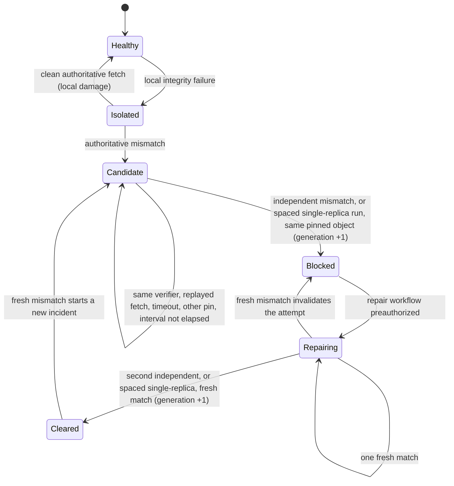

# Durable artifact damage: verifiers, pins, findings and repair

This page defines what Phase 8 needs before implementation: verifier identities, storage pins and durable finding records. It then specifies how a damaged Datastore artifact moves from local isolation through a fleet block and a verified repair to clearance. It implements [R10](airk-analysis.md#r10), [ART1](airk-analysis.md#art1) and [ART2](airk-analysis.md#art2) as an opt-in Server feature. [Delivery phases](README.md#phase-8-record-and-recover-from-durable-artifact-damage) · [REL1](README.md#rel1)

**Status.** Local implementation follows the accepted and amended hub ADR 0028.
The versioned export remains pending. The tests below use deterministic local
fixtures. The ART1 and ART2 receipts still require the designated workstation
fleet. [Decision register](README.md#5-maintainer-decision-register)
· [Cluster qualification plan](cluster-qualification-plan.md)

## Definitions

### Verifier identity

**Amendment, 20 November 2026.** The maintainer decision of 20 November 2026 rests verifier independence on a per-replica authenticated workload identity rather than on a configured instance id over the shared database credential. This amends the verifier definition recorded in hub ADR 0028 (artifact damage confirmation, fleet block and verified repair).

A verifier identity is an enrolled verifier key plus one verifier run:

| Part | Value | Purpose |
|---|---|---|
| `verifier_id` | The fingerprint of the replica's Ed25519 verifier key: `ed25519:` and the hex SHA-256 of the 32-byte public key | Who observed. Independence is judged on this value alone. |
| `run_id` | A fresh random identifier per verifier run | Which run observed. Distinguishes runs in the history and never makes two runs independent. |
| `fetch_id` | A fresh random identifier per authoritative fetch | Which fetch was observed. A fetch counts once, whatever name submits it. |

**Verifier keys.** Each serving replica holds its own Ed25519 signing key, read at startup from the file named by `MUNARIUM_ARTIFACT_VERIFIER_KEY_FILE` (one unpadded base64url 32-byte seed). The operator enrolls the replica's public key in `artifact_verifier_keys` (migration `0083_artifact_verifier_keys.sql`) with `munarium-server artifact-damage enroll-verifier`, and can revoke it permanently with `revoke-verifier`. The table holds public material only.

**Signed observations.** A replica signs every authoritative observation, mismatch, match or unavailable alike. The signature covers a domain-separated, length-prefixed encoding of the tenant, the pin (index version, artifact id, object key, expected digest, storage generation), the pin's integrity generation, the outcome and observed digest, the verifier id, run id, fetch id, fetch time and any repair attempt (`munarium_core::artifact_verifier`). The ledger counts an observation toward a block or a clearance only when all of the following hold:

- it is signed;
- its `verifier_id` is the fingerprint of an enrolled key that is not revoked;
- its signed integrity generation is the pin's generation when it is recorded;
- the signature verifies (strict Ed25519) over those claims for this tenant.

Anything else is recorded as `unauthenticated` and counts for nothing: no candidate, no confirmation, no repair match. A replica without a key, or whose key is not enrolled, therefore still isolates its local copy and records what it saw, but cannot contribute to a fleet block or a clearance. An unconfirmed candidate or first repair match whose key is revoked before confirmation is replaced by the next authenticated observation, never confirmed. Committed incidents keep the fingerprints they recorded.

Two observations are **independent** only when all of the following hold:

1. Their `verifier_id`s differ, so they were signed by two distinct enrolled keys. A verifier running twice, retrying or restarting under the same key counts once, and so do two replicas that share one key.
2. Their `fetch_id`s differ. Replaying one fetch under a second name counts once.
3. Each fetched the pinned object directly from the authoritative artifact store (L2), never from an L1 or L0 copy.
4. Both concern the same pinned object (defined below) at the pin's current integrity generation.
5. Both completed with a digest. A timeout or an unreadable object is *unavailable* and counts for nothing.
6. For a block, their fetch times are within 24 hours of each other. For a clearance, both fetches started after the repair attempt was authorized.

A deployment declared single-replica replaces criterion 1 with temporal and fetch independence from the same verifier. See [Single-replica assurance](#single-replica-assurance).

**Authentication and authorization.** A verifier is a Server replica in `observe` or `enforce` mode holding an enrolled verifier key. Enrollment authorizes it for every tenant and pin that replica serves, which is the same authority a replica already has over the catalog. Replicas still share one database credential, so the database cannot tell their connections apart. Independence rests on the keys instead. Each replica must have its own key, and an operator who gives two replicas copies of one key makes them one verifier. Enrollment and revocation run with the deployment's database credential, the same operator boundary as `authorize-repair` and migrations. Anyone holding that credential could also enroll a key or write the ledger tables directly, so the keys defend against misconfigured, impersonating or replayed observers, not against a database administrator. Binding the verifier key to the platform-v1 workload certificate remains a possible later hardening step. Without a key file, a replica logs that its observations will not count.

### Storage pin

A storage pin names exactly what is trusted:

| Field | Source |
|---|---|
| Tenant and logical version | The catalog row's key. Identical bytes in two tenants are two pins. |
| `artifact_id` | `sha256` of the canonical manifest bytes. The manifest's expected digest is the artifact id itself. |
| Manifest key | `manifest.json` under the artifact's catalog prefix (`artifact_uri`). |
| Component digests | Each component's `path`, `bytes_len` and `sha256`, read from manifest bytes that hash to the artifact id. The ledger also checks each digest against the catalog's manifest projection, so an observation cannot name a digest the pin does not contain. |
| Storage generation | The store's object generation when the store reports one: the version id where the store reports one, else the ETag, taken from the same read that returned the bytes (`ArtifactStore::get_component_with_generation`). The object-store backends (S3, Azure, GCS and the in-memory store) report one. The local-file store reports none, so its observations record it as absent. Two observations of different stored generations are different pinned objects. See [Storage generations](#storage-generations). |

A **pinned object** is one of these objects together with its expected digest and storage generation. An **artifact pin** is the whole artifact, and it is what a block withdraws. Verification runs the `munarium_datastore::audit::audit_artifact` function. It hashes the manifest before parsing it, then fetches and hashes every component in manifest order. When several objects differ, verifiers report the first mismatch in manifest order, so two verifiers that see the same damage name the same object.

### Storage generations

**Decision, 20 November 2026.** The maintainer decided open question 2: the `ArtifactStore` trait reports an object's stored generation when the backend has one, and blocks and clearances bind to it.

- **Where it comes from.** `ArtifactStore::get_component_with_generation` returns the bytes and the generation of the object they were read from, in one read, so the generation names exactly the bytes that were hashed. `munarium_datastore::store::storage_generation_token` forms the recorded value: `version:<id>` when the store reports a version id, else `etag:<etag>`, so a version id never equals an ETag with the same text. A value longer than 128 bytes, or one with control characters, is recorded as `sha256:` and the digest of the reported text. The default trait method, which the local-file store uses, reports none.
- **What records it.** `audit_artifact` records each object's generation. Every authoritative observation carries the generation of the object it names, signed with the rest of the pin. The history records it on every authoritative entry, a candidate and its incident record the generation of the mismatches, and a repair attempt records the generation of its first match. `artifact-damage list` shows `storage_generation` (the block's) and `clear_storage_generation` (the clearance's, which is the clearing attempt's match generation). No migration is needed: the 0060 tables already carry the columns, with `''` for absent.
- **Blocks.** Candidates are keyed by the full pinned object, generation included. A mismatch on another generation starts its own candidate and never confirms one recorded at a different generation.
- **Clearances.** Two repair matches clear only when both observed the same generation. A match on a different generation from the attempt's first match replaces that first match rather than confirming it, because the earlier match says nothing about the object now stored. Clearance then needs a second independent match on the new generation. Before this decision such a match was rejected and the first match stayed in place.
- **Absent generations.** A store that reports none behaves exactly as before: every observation records absent, and absent observations of one object combine as they always have.
- **Mixed absent and known.** Absent is its own value, never a wildcard. An absent and a known generation of the same object never combine toward a block or a clearance, in either order. This is the conservative choice: a replica whose store reports no generation cannot confirm or clear what another replica saw at a known generation, and the reverse. Replicas should therefore read the authoritative store through the same backend.

**Consequences.** A rewrite of an object, even with identical bytes, is a new generation, and so is a metadata-only change on a store that changes the ETag for one. Both make the fleet less likely to block, because verifiers that read different generations do not combine. Neither makes it more likely to clear. During verification, a generation change in a two-replica fleet can stall an attempt: the first replica's match is replaced, and that replica does not verify the same attempt twice. Authorize a new workflow to start a fresh attempt. A declared single replica re-verifies after the interval as usual.

### Durable finding records

Migration `0060_artifact_damage.sql` adds five tenant-scoped tables. None stores corpus or query text.

| Table | One row per | Bound |
|---|---|---|
| `artifact_integrity_pins` | Artifact pin with any finding: integrity `generation`, `state` (`observed`, `blocked`, `cleared`) and the active incident | Catalogued artifacts (foreign key) |
| `artifact_integrity_candidates` | First unconfirmed authoritative mismatch per pinned object, at the generation it was recorded | Components per artifact (the manifest limits) |
| `artifact_integrity_incidents` | Committed block with its two confirming observations, and, when cleared, the two verifications, attempt and workflow identity. Migration `0082_artifact_damage_assurance.sql` adds `block_assurance` and `clear_assurance` | One per block. Blocks require two independent verifiers, or one declared single replica's two spaced runs |
| `artifact_repair_attempts` | Preauthorized repair workflow scoped to one incident, with its first fresh match | One verifying attempt per incident |
| `artifact_integrity_observations` | Every recorded observation and the ledger's decision on it | 1,024 per tenant |

The observation history is bounded separately from the decision state. When the history is full, a new observation is not appended and existing entries are never evicted. Nothing prunes the history, and clearing an incident frees no entry, so a full history stays full. The caller is told the history is full and logs that repair or review is required. Candidates, incidents and attempts carry their own evidence, so a full history can still block a newly confirmed pin, recover the evidence for that block and clear it. **No row means unknown integrity.** The absence of a finding is never reported as a clean audit.

Each pin's `generation` starts at 0. It advances by one when a block commits and by one when a clearance commits, and at no other time. A candidate recorded at an earlier generation never confirms a block.

### Single-replica assurance

**Amendment, 20 November 2026.** This section records the maintainer decision of 20 November 2026 that single-replica deployments must be able to block and clear. It amends the independence rule recorded in hub ADR 0028 (artifact damage confirmation, fleet block and verified repair) for deployments that declare a single replica. The default rule above is unchanged.

A deployment with one serving replica has one verifier identity, so the default rule can never block or clear there. An operator who declares the deployment single-replica (`MUNARIUM_ARTIFACT_DAMAGE_REPLICAS=single`) lets the ledger accept that verifier's own second observation in place of a second verifier, under all of these conditions:

1. Both observations are authenticated and come from the same `verifier_id` (one enrolled key), from **different runs** (`run_id`) and **different direct fetches** (`fetch_id`). A replayed fetch still counts once, and a run never confirms itself.
2. The second fetch started at least the **single-replica interval** after the first (`MUNARIUM_ARTIFACT_DAMAGE_SINGLE_INTERVAL_SECS`, default 300 seconds, accepted range 60 to 3,600), and not in the future by the database clock. A second run inside the interval is recorded as `interval_not_elapsed` and counts for nothing. The first observation stays the reference, so waiting longer is the only way to confirm.
3. Every other criterion holds: same pinned object at the current integrity generation, authoritative (L2) fetches, digests present, the 24-hour confirmation window for a block, and fetches after the repair authorization for a clearance. A fresh mismatch during verification still invalidates the attempt.

Two observations from **different** verifier identities still confirm in a single-replica deployment, and are recorded as independent.

**The interval.** The default of five minutes is chosen to be conservative rather than fast. It spans many readiness sweeps (15 seconds by default), so the two runs are separate verifier passes rather than a retry. It also outlasts the usual causes of a transient wrong read: an in-flight rewrite or republish of the object, object-store read-after-write or cache-propagation delay, and a short storage or network fault. A persistent mismatch five minutes apart is much less likely to be transient. The interval stays short against the 24-hour confirmation window, so a block lands within minutes of the first finding. The 60-second floor is also enforced by the schema on every `single_replica` row. The one-hour cap keeps a confirmation well inside the window.

**How the replica supplies the second run.** A single replica isolates its copy once, so ordinary reads produce no second observation. In its readiness sweep it therefore re-verifies, once per candidate, every unconfirmed candidate whose first fetch is at least the interval old and still within the window. For a repair it verifies the attempt once, then once more after the interval. A default (`multi`) replica does neither.

**Assurance is recorded.** Every incident records `block_assurance`, and once cleared `clear_assurance`: `independent` for two verifier identities and `single_replica` for one. The 0082 CHECKs accept a same-verifier block or clearance only when it is marked `single_replica` and its two runs and fetches differ and are at least 60 seconds apart. An `independent` row must still name two different verifiers. `artifact-damage list` shows both fields.

**Refusal.** `single` is refused when the deployment declares more than one replica (`MUNARIUM_REPLICA_COUNT` above 1), and an unknown value or an interval outside the range is refused rather than falling back. In each case the Datastore infrastructure does not arm, as for an unknown damage mode. The replica count is the only observable signal. The per-process heartbeat rows are soft state and change identity on restart, so they are not used.

**Residual risk.** Single-replica assurance is one replica's view. A systematically wrong local verifier, such as a bad build, a faulty storage client, a misconfigured store endpoint or a broken hashing path, sees the same wrong answer on both runs. It could therefore both block a healthy artifact and clear a damaged one. Temporal separation only protects against transient faults. An operator who declares `single` while actually running more replicas under one replica count also weakens the rule, because each replica then confirms alone. The recorded `single_replica` assurance lets an audit find every such decision. Where this risk matters, run a second replica with a distinct instance id: its observations confirm under the default rule and are recorded as `independent`.

## The state machine

1. **Local isolation.** The first integrity failure stops this replica using its own copy immediately. A hydration failure quarantines the L1 key. A copy that fails at open is evicted, and its L0 shard is dropped. The replica records a `local_isolation` finding. Local isolation never counts toward a fleet block.
2. **Authoritative verification.** The isolating replica then fetches the pin directly from L2 and records one authoritative observation. A clean fetch after local damage records a match: the local copy stays isolated or evicted, no fleet effect follows, and the next read re-fetches and re-verifies. A mismatch becomes the pinned object's candidate. A refusal of a key that was already quarantined does not run a new verification.
3. **Fleet block.** A second independent mismatch on the same pinned object, at the same generation, commits the block in one transaction. That transaction inserts the incident with both confirming observations, advances the pin's generation, sets `blocked` and drops the pin's candidates. A replica in `observe` mode records the confirmation as `block_withheld` and leaves the candidate in place, so an enforcing replica can still confirm against it.
4. **Repair.** Changing the object bytes is separately authorized and outside this feature, for example republishing the component from a verified copy. An operator then preauthorizes a repair workflow for the active incident (see below). The verification window opens at that moment.
5. **Clearance.** Each serving replica verifies a preauthorized attempt once. Its observation is bound to the tenant, object, component, active incident and attempt, and it must match the incident's object and expected digest. A match counts only when the whole artifact audit is clean. When a second verifier's fresh match arrives, the same transaction marks the incident `cleared` with both verifications, the attempt id and the workflow id. It also completes the attempt, advances the pin's generation, sets `cleared` and drops candidates. The transition is atomic and idempotent: repeated delivery, a further match or a late report refers to an attempt that is no longer verifying and changes nothing.

An observation cannot clear a block when it:

- names no attempt, an unknown attempt or a forged attempt;
- names an attempt that is cleared, invalidated or superseded;
- names an attempt for a different pin or for an earlier incident;
- was fetched before the attempt was authorized;
- is the same verifier's second match or the same fetch replayed;
- matches a different object;
- comes from an `observe` replica, which records it as `clear_withheld`.

A fresh mismatch during verification invalidates the attempt and voids its earlier match. A new authorization is then needed.

After clearance, a replica that isolated its copy before the block sees the pin at a later generation and no block. Before admitting that key again, it discards the quarantined copy and evicts it from L1 and L0. The next hydration re-fetches the bytes and verifies them against the trusted pin. A warm replica whose local copy was never isolated keeps it. That copy was verified against the same pin at hydration, and a repair restores the pinned bytes rather than changing the pin.

## Admission and the release fence

Readers apply the fence in `ArtifactExecutor::execute` and `ServingPlane::search`:

1. **Admission.** After resolving the serving binding and checking that the catalog row is `verified`, the reader reads the pin row. A blocked pin is refused before any local byte is used. This applies to cold, warm and restarted readers alike, and to readers with good local bytes. An unavailable check also refuses the read. The reader captures the pin's generation.
2. **Release.** After execution and every other refusal check, the serving plane share-locks the pin rows in a stable order. It authorizes the result only if each pin is still at its admitted generation and unblocked. A block that commits first refuses every outstanding read admitted at the earlier generation, even if a clearance follows before the read finishes. A result already authorized can still be delivered later. An unavailable release check suppresses the output with `datastore-unavailable`.

The fence works on whole search results. A turn or stream that carries artifact-derived content does so only from search results that have passed release. Content authorized before the block can therefore be emitted after it, and content from a search that fails release never appears. The fence does not add a separate check per streamed event. A stream assembles each event from results already released, and none of its events carries artifact content that a separate release did not authorize. Content already delivered and its audit history are preserved.

The readiness warmer does not hydrate or open a blocked pin, and records its residency as `blocked`. A block does not withdraw a replica's readiness. Every replica refuses the pin alike, so withdrawing readiness would turn one integrity incident into an outage of every other scope. Selecting the datastore for a scope (`PUT /v1/retrieval-rollout`) refuses while any serving-required artifact is blocked, whatever the replica's mode.

## Who may clear a block

Only a preauthorized repair workflow may clear a block, and only through two fresh, independent digest matches on the correct pin. The clearance is recorded on the incident.

- **Preauthorization** is `munarium-server artifact-damage authorize-repair --tenant T --incident I --workflow W --actor A`. It runs with the deployment's database credential and is the same operator boundary as migrations and `platform-enroll`. It grants workflow `W` clearance authority for incident `I` only. It does not change bytes and does not clear anything by itself. Repeating it with the same workflow returns the verifying attempt. A different workflow supersedes the verifying attempt and voids its match.
- **Verification** is performed by serving replicas in their readiness sweep, as above.
- **Clearance** is committed by the ledger when the second independent match arrives, under the attempt's authority. Its record holds the workflow id, the attempt id, both verifier identities, both fetch ids and fetch times, and the observed digests.

No `/v1` route, console action or REST role can clear a block. [Operator procedure](../ops/artifact-damage.md) · [Security posture](../security-posture.md)

## Publication of a blocked pin

**Decision, 20 November 2026.** The maintainer decided open question 5: mirror publication refuses a blocked pin until an ART2 repair clears it.

A rebuild of unchanged content converges on the artifact id it built before. It either reuses the verified artifact or its catalog insert converges on the existing row. Before this decision such a build reported success with a blocked artifact as its result, and a queued build could fill an empty `staged` slot with it. The publication path in `munarium_retrieval::mirror` now reads the pin's block, the same read as serving admission, wherever a build would take a pin as its result:

- when it reuses a verified artifact for the plan, before binding `staged` or reporting `already_built`;
- when its catalog insert converges on an existing verified row, before reporting `converged`;
- before uploading any component (`publish_and_verify`, for fresh and resumed publications);
- when the sealed-attempt reconciler finds the artifact already verified, before binding it.

The outcome depends on `MUNARIUM_ARTIFACT_DAMAGE_MODE` on the building replica, read when the build context is made:

| Mode | A build whose result is a blocked pin |
|---|---|
| `off` (default) | Unchanged: no check is made. |
| `observe` | Publishes as before. Logs `a build's result is a fleet-blocked artifact` with the version, artifact and incident ids, and counts `munarium_artifact_publication_blocked_total{mode="observe",action="published"}`. Serving still refuses the pin. |
| `enforce` | Refused. The build fails with its own error type, `artifact-blocked` (409, `FAILED_PRECONDITION`), naming only the version, artifact and incident ids. A build job records `error_code` `artifact_blocked` (C2) with that code's fixed message. Nothing is bound or uploaded. Counts `action="refused"`. |

This matches how serving treats the modes: `observe` honors and reports existing blocks without acting on its own authority, and `enforce` refuses. The refusal is classified apart from `datastore-unavailable` because it is not transient: a block clears only after a verified repair, so `artifact-blocked` carries no R11 retry hint, where `datastore-unavailable` carries `retry_later`. The classification comes from the error's type, never its text. An unavailable pin check refuses the build in `enforce` with `datastore-unavailable` (job code `datastore_unavailable`), as an unavailable admission check refuses a read, because that condition can pass. In `observe` it is only logged. An unknown mode refuses the build context, as it refuses to arm serving. Once a verified repair clears the block, the same pin publishes normally. The refusal is a publication-time check, not a fence: a block that commits after the check is still enforced by every reader's admission and release.

## Modes, upgrade and rollback

`MUNARIUM_ARTIFACT_DAMAGE_MODE` selects the behavior on each replica that builds Datastore parts. Those are replicas in `shadow` and `datastore` retrieval modes.

| Mode | Behavior |
|---|---|
| `off` (default) | The v1.4 behavior. Quarantine is per process only. Executors carry no damage context, and nothing reads or writes the new tables. |
| `observe` | Isolates locally, records findings and verifications, and honors existing blocks at admission and release. Reports, without refusing, a build whose result is a blocked pin. Never commits a block or a clearance. |
| `enforce` | `observe`, plus commits confirmed blocks and verified clearances, and refuses to publish a blocked pin. |

An unknown value is a configuration error. The Datastore infrastructure then refuses to arm and a `datastore` replica stays unready. It never falls back silently to `off`.

**Activation.** Roll every serving replica to `observe` first, and drain or replace any v1.4 reader. Then switch them to `enforce`. A block can only commit once every reader can enforce it.

`MUNARIUM_ARTIFACT_DAMAGE_REPLICAS` selects the independence rule: `multi` (default) or `single`. `MUNARIUM_ARTIFACT_DAMAGE_SINGLE_INTERVAL_SECS` sets the single-replica interval (default 300). See [Single-replica assurance](#single-replica-assurance).

**Rollback.** Before returning a replica to `off` while a block is outstanding, withdraw the affected scope. Set its rollout selector to `postgres`, or keep the artifact out of the `serving` slot. An `off` reader cannot see the block; a later switch back finds the block still in force. Returning to a v1.4.0 binary is by restoring the pre-upgrade backup ([rolling back to 1.4.0](../guides/server-1.5.md#rolling-back-to-140)). The restored database predates the block, so withdraw or repair the affected artifact before v1.4.0 serves it.

## Validation and coverage

| Acceptance case | Local evidence |
|---|---|
| ART1-T1 single verifier, same verifier twice, replayed fetch, timeout, different pin, different storage generation | `munarium-store-pg/tests/artifact_damage.rs`. The serving-path test also records one replica's hydration failure and a second run by the same verifier. |
| ART1-T1 clean authoritative fetch after local cache damage | `local_damage_with_a_clean_authoritative_fetch_does_not_block` (server) |
| ART1-T2 cold, warm and restarted readers refuse; an in-flight read admitted before the block fails release; a result released before the block stays authorized; another tenant with identical bytes; a full history | Ledger tests and `independent_confirmation_blocks_warm_and_restarted_readers` (server) |
| ART2-T1 unauthorized, pre-repair, single-match, same-verifier, replayed, different-object, observe-mode and invalidated repairs leave the block; a valid repair clears once and records the clearance | Ledger tests and `a_preauthorized_verified_repair_clears_and_readers_recover` (server) |
| ART2-T2 late report from an earlier incident; in-flight read after clearance; quarantined copy re-verified; fresh mismatch starts a new incident | Same |
| Default mode records nothing durable | `the_default_mode_records_nothing_durable` (server) |
| Authenticated verifiers: unsigned, forged, borrowed, altered, other-tenant, other-generation, unenrolled and revoked observations count for nothing; two replicas sharing a key are one verifier; a revoked key's candidate or first match is never confirmed; distinct enrolled keys block and clear; enrollment is idempotent and revocation permanent; key commands never print the private key | `an_unsigned_or_forged_observation_counts_for_nothing`, `an_unenrolled_key_never_counts`, `two_replicas_sharing_one_key_are_one_verifier`, `a_revoked_key_counts_for_nothing_and_its_evidence_is_not_confirmed`, `enrollment_is_idempotent_and_revocation_is_permanent` (ledger); `keyless_and_key_sharing_replicas_only_isolate_locally`, `the_verifier_key_commands_enroll_and_revoke_without_exposing_the_key` (server); `artifact_verifier` unit tests (core) |
| Single-replica assurance: spaced runs block and clear; runs inside the interval, a replayed fetch, the same run or a future fetch time do not; the default ledger never counts one verifier twice; assurance recorded; schema refuses unmarked or unspaced same-verifier rows; `single` refused above one declared replica | `single_replica_*`, `the_default_ledger_never_counts_one_verifier_twice_however_spaced` and `the_schema_admits_a_same_verifier_block_only_when_marked_and_spaced` (ledger); `a_declared_single_replica_blocks_and_clears_with_spaced_runs` (server); `replica_assurance_tests` (retrieval) |

| Storage generations: different generations never confirm a block or a clearance; an absent and a known generation never combine, in either order; absent-generation stores block and clear as before; the block's and the clearance's generations are listed | `mismatches_of_different_stored_generations_never_combine_toward_a_block`, `an_absent_generation_never_combines_with_a_known_one_toward_a_block`, `repair_matches_of_different_stored_generations_never_clear`, `absent_generation_repairs_clear_as_before` (ledger); `each_object_carries_the_generation_its_bytes_were_read_at` (audit); `a_read_reports_the_stored_generation_and_a_rewrite_changes_it` (object store); `the_local_store_reports_no_generation`, `generation_tokens_are_kinded_bounded_and_prefer_the_version` (store) |
| Publication of a blocked pin: refused in `enforce` with `artifact_blocked` and nothing rebound; published and reported in `observe`; unchanged in `off`; an unblocked pin publishes; publishes again after clearance; an unavailable check refuses only in `enforce`, as `datastore_unavailable`; the refusal is classified by type and carries no retry hint on either transport | `munarium-retrieval/tests/blocked_publication.rs`; `classification_maps_types_and_never_copies_cause_text` (store-pg `job_failure`); `a_blocked_artifact_is_not_retryable_on_either_transport` (server R11); `a_blocked_artifact_is_a_failed_precondition_without_a_retry_hint` (server gRPC proxy) |

**Not covered locally.** The following remain uncovered: paused second replicas on a real fleet, a stream spanning a block on a live server, an unavailable final check against a failing database, concurrent failures across processes, binary rollback, and healthy reads on every serving replica after clearance. These are the REL1 fleet receipts. [Cluster qualification plan](cluster-qualification-plan.md)

## Open questions

1. **Verifier authentication.** Decided on 20 November 2026: independence requires distinct enrolled verifier keys (see [Verifier identity](#verifier-identity)). Binding those keys to the platform-v1 workload certificate is a possible later hardening step.
2. **Storage generations.** Decided on 20 November 2026: the trait reports a generation when the backend has one, different generations never combine, and an absent generation never combines with a known one (see [Storage generations](#storage-generations)).
3. **Per-result authorization records.** The release fence commits a share-locked check, not a durable row per result. Durable per-result records would add a write to every search and need their own retention.
4. **Bounds.** Are the 1,024-entry history and the 24-hour confirmation window the right defaults? Both are constants today.
5. **Mirror publication.** Decided on 20 November 2026: publication refuses a blocked pin in `enforce` until an ART2 repair clears it, reports it in `observe`, and is unchanged in `off` (see [Publication of a blocked pin](#publication-of-a-blocked-pin)).
