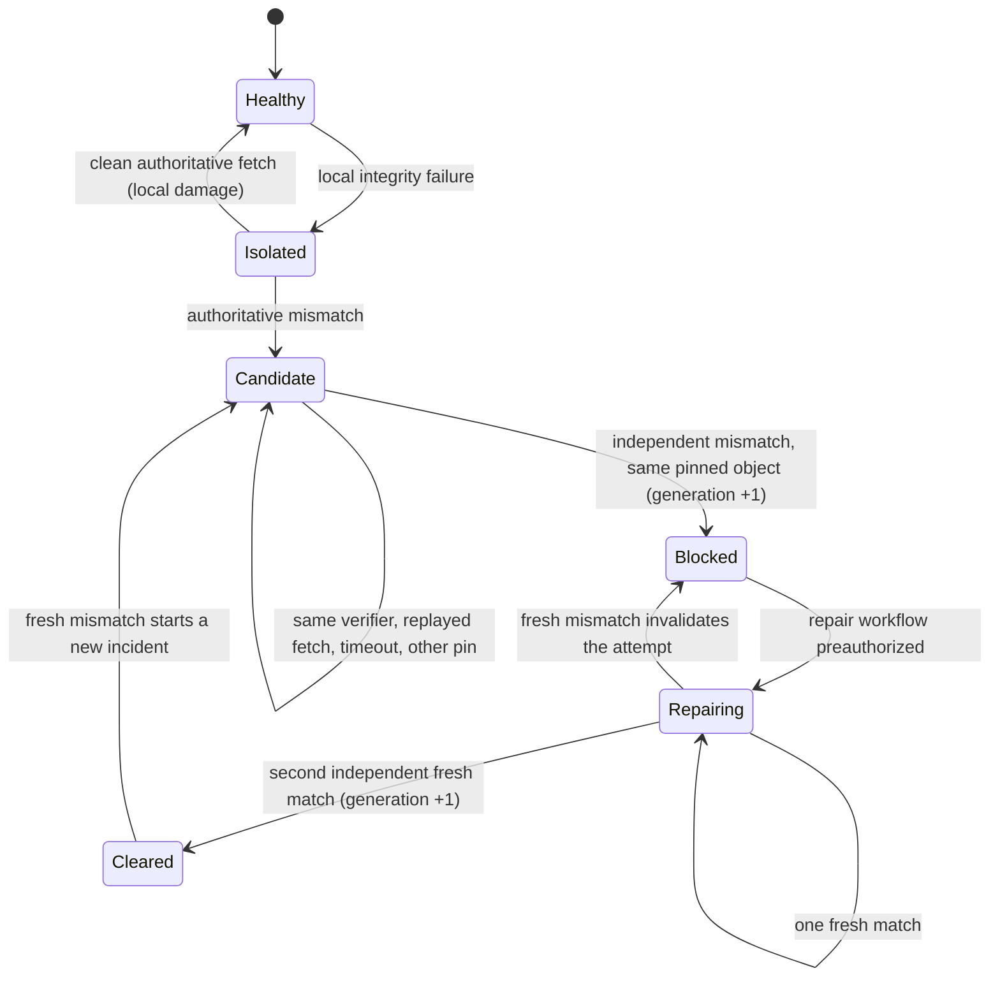

# Durable artifact damage: verifiers, pins, findings and repair

This page defines what Phase 8 needs before implementation: verifier identities, storage pins and durable finding records. It then specifies how a damaged Datastore artifact moves from local isolation through a fleet block and a verified repair to clearance. It implements [R10](airk-analysis.md#r10), [ART1](airk-analysis.md#art1) and [ART2](airk-analysis.md#art2) as an opt-in Server feature. [Delivery phases](README.md#phase-8-record-and-recover-from-durable-artifact-damage) · [REL1](README.md#rel1)

**Status: proposal for maintainer review.** The definitions below are the Server component's proposed choices. The ART1 and ART2 hub decision records are still pending. A hub record that differs from these definitions takes precedence and requires this page and the implementation to change. Multi-replica receipts on a real fleet are deferred cluster work. The local tests listed at the end are deterministic single-process stand-ins. [Decision register](README.md#5-maintainer-decision-register) · [Cluster qualification plan](cluster-qualification-plan.md)

## Definitions

### Verifier identity

A verifier identity is a serving replica plus one verifier run:

| Part | Value | Purpose |
|---|---|---|
| `verifier_id` | `{MUNARIUM_DEPLOYMENT_ENVIRONMENT_ID}/{instance id}`, where the instance id is `MUNARIUM_INSTANCE_ID`, `HOSTNAME` or `COMPUTERNAME` | Who observed. Independence is judged on this value alone. |
| `run_id` | A fresh random identifier per verifier run | Which run observed. Distinguishes runs in the history and never makes two runs independent. |
| `fetch_id` | A fresh random identifier per authoritative fetch | Which fetch was observed. A fetch counts once, whatever name submits it. |

Two observations are **independent** only when all of the following hold:

1. Their `verifier_id`s differ. A verifier running twice, retrying or restarting under the same identity counts once.
2. Their `fetch_id`s differ. Replaying one fetch under a second name counts once.
3. Each fetched the pinned object directly from the authoritative artifact store (L2), never from an L1 or L0 copy.
4. Both concern the same pinned object (defined below) at the pin's current integrity generation.
5. Both completed with a digest. A timeout or an unreadable object is *unavailable* and counts for nothing.
6. For a block, their fetch times are within 24 hours of each other. For a clearance, both fetches started after the repair attempt was authorized.

**Authentication and authorization (proposal).** In this release a verifier is a Server replica running with the deployment's PostgreSQL credential in `observe` or `enforce` mode. It is authorized for every tenant and pin that replica serves, which is the same authority a replica already has over the catalog. Replicas share one database credential, so the database cannot tell replicas apart. Independence therefore depends on the deployment giving each replica a distinct, stable instance id. Kubernetes pod names satisfy this, as do the chart and compose defaults. An operator who assigns two replicas the same `MUNARIUM_INSTANCE_ID` makes them one verifier. A per-replica authenticated identity, such as the platform-v1 workload certificate, is the recorded hardening path. It needs the ART1 hub decision. See [Open questions](#open-questions).

### Storage pin

A storage pin names exactly what is trusted:

| Field | Source |
|---|---|
| Tenant and logical version | The catalog row's key. Identical bytes in two tenants are two pins. |
| `artifact_id` | `sha256` of the canonical manifest bytes. The manifest's expected digest is the artifact id itself. |
| Manifest key | `manifest.json` under the artifact's catalog prefix (`artifact_uri`). |
| Component digests | Each component's `path`, `bytes_len` and `sha256`, read from manifest bytes that hash to the artifact id. The ledger also checks each digest against the catalog's manifest projection, so an observation cannot name a digest the pin does not contain. |
| Storage generation | The store's object generation (ETag or version id) when the store reports one. The `ArtifactStore` trait does not expose one today, so every observation records it as absent. Two observations of different stored generations are different pinned objects. |

A **pinned object** is one of these objects together with its expected digest and storage generation. An **artifact pin** is the whole artifact, and it is what a block withdraws. Verification runs the `munarium_datastore::audit::audit_artifact` function. It hashes the manifest before parsing it, then fetches and hashes every component in manifest order. When several objects differ, verifiers report the first mismatch in manifest order, so two verifiers that see the same damage name the same object.

### Durable finding records

Migration `0060_artifact_damage.sql` adds five tenant-scoped tables. None stores corpus or query text.

| Table | One row per | Bound |
|---|---|---|
| `artifact_integrity_pins` | Artifact pin with any finding: integrity `generation`, `state` (`observed`, `blocked`, `cleared`) and the active incident | Catalogued artifacts (foreign key) |
| `artifact_integrity_candidates` | First unconfirmed authoritative mismatch per pinned object, at the generation it was recorded | Components per artifact (the manifest limits) |
| `artifact_integrity_incidents` | Committed block with its two confirming observations, and, when cleared, the two verifications, attempt and workflow identity | One per block. Blocks require two independent verifiers |
| `artifact_repair_attempts` | Preauthorized repair workflow scoped to one incident, with its first fresh match | One verifying attempt per incident |
| `artifact_integrity_observations` | Every recorded observation and the ledger's decision on it | 1,024 per tenant |

The observation history is bounded separately from the decision state. When the history is full, a new observation is not appended and existing entries are never evicted. The caller is told the history is full and logs that repair or review is required. Candidates, incidents and attempts carry their own evidence, so a full history can still block a newly confirmed pin, recover the evidence for that block and clear it. **No row means unknown integrity.** The absence of a finding is never reported as a clean audit.

Each pin's `generation` starts at 0. It advances by one when a block commits and by one when a clearance commits, and at no other time. A candidate recorded at an earlier generation never confirms a block.

## The state machine

1. **Local isolation.** The first integrity failure stops this replica using its own copy immediately. A hydration failure quarantines the L1 key. A copy that fails at open is evicted, and its L0 shard is dropped. The replica records a `local_isolation` finding. Local isolation never counts toward a fleet block.
2. **Authoritative verification.** The isolating replica then fetches the pin directly from L2 and records one authoritative observation. A clean fetch after local damage records a match: the local copy stays isolated or evicted, no fleet effect follows, and the next read re-fetches and re-verifies. A mismatch becomes the pinned object's candidate. A refusal of a key that was already quarantined does not run a new verification.
3. **Fleet block.** A second independent mismatch on the same pinned object, at the same generation, commits the block in one transaction. That transaction inserts the incident with both confirming observations, advances the pin's generation, sets `blocked` and drops the pin's candidates. A replica in `observe` mode records the confirmation as `block_withheld` and leaves the candidate in place, so an enforcing replica can still confirm against it.
4. **Repair.** Changing the object bytes is separately authorized and outside this feature, for example republishing the component from a verified copy. An operator then preauthorizes a repair workflow for the active incident (see below). The verification window opens at that moment.
5. **Clearance.** Each serving replica verifies a preauthorized attempt once. Its observation is bound to the tenant, object, component, active incident and attempt, and it must match the incident's object and expected digest. A match counts only when the whole artifact audit is clean. When a second verifier's fresh match arrives, the same transaction marks the incident `cleared` with both verifications, the attempt id and the workflow id. It also completes the attempt, advances the pin's generation, sets `cleared` and drops candidates. The transition is atomic and idempotent: repeated delivery, a further match or a late report refers to an attempt that is no longer verifying and changes nothing.

An observation cannot clear a block when it:

- names no attempt, an unknown attempt or a forged attempt;
- names an attempt that is cleared, invalidated or superseded;
- names an attempt for a different pin or for an earlier incident;
- was fetched before the attempt was authorized;
- is the same verifier's second match or the same fetch replayed;
- matches a different object;
- comes from an `observe` replica, which records it as `clear_withheld`.

A fresh mismatch during verification invalidates the attempt and voids its earlier match. A new authorization is then needed.

After clearance, a replica that isolated its copy before the block sees the pin at a later generation and no block. Before admitting that key again, it discards the quarantined copy and evicts it from L1 and L0. The next hydration re-fetches the bytes and verifies them against the trusted pin. A warm replica whose local copy was never isolated keeps it. That copy was verified against the same pin at hydration, and a repair restores the pinned bytes rather than changing the pin.

## Admission and the release fence

Readers apply the fence in `ArtifactExecutor::execute` and `ServingPlane::search`:

1. **Admission.** After resolving the serving binding and checking that the catalog row is `verified`, the reader reads the pin row. A blocked pin is refused before any local byte is used. This applies to cold, warm and restarted readers alike, and to readers with good local bytes. An unavailable check also refuses the read. The reader captures the pin's generation.
2. **Release.** After execution and every other refusal check, the serving plane share-locks the pin rows in a stable order. It authorizes the result only if each pin is still at its admitted generation and unblocked. A block that commits first refuses every outstanding read admitted at the earlier generation, even if a clearance follows before the read finishes. A result already authorized can still be delivered later. An unavailable release check suppresses the output with `datastore-unavailable`.

The fence works on whole search results. A turn or stream that carries artifact-derived content does so only from search results that have passed release. Content authorized before the block can therefore be emitted after it, and content from a search that fails release never appears. The fence does not add a separate check per streamed event. A stream assembles each event from results already released, and none of its events carries artifact content that a separate release did not authorize. Content already delivered and its audit history are preserved.

The readiness warmer does not hydrate or open a blocked pin, and records its residency as `blocked`. A block does not withdraw a replica's readiness. Every replica refuses the pin alike, so withdrawing readiness would turn one integrity incident into an outage of every other scope. Selecting the datastore for a scope (`PUT /v1/retrieval-rollout`) refuses while any serving-required artifact is blocked, whatever the replica's mode.

## Who may clear a block

Only a preauthorized repair workflow may clear a block, and only through two fresh, independent digest matches on the correct pin. The clearance is recorded on the incident.

- **Preauthorization** is `munarium-server artifact-damage authorize-repair --tenant T --incident I --workflow W --actor A`. It runs with the deployment's database credential and is the same operator boundary as migrations and `platform-enroll`. It grants workflow `W` clearance authority for incident `I` only. It does not change bytes and does not clear anything by itself. Repeating it with the same workflow returns the verifying attempt. A different workflow supersedes the verifying attempt and voids its match.
- **Verification** is performed by serving replicas in their readiness sweep, as above.
- **Clearance** is committed by the ledger when the second independent match arrives, under the attempt's authority. Its record holds the workflow id, the attempt id, both verifier identities, both fetch ids and fetch times, and the observed digests.

No `/v1` route, console action or REST role can clear a block. [Operator procedure](../ops/artifact-damage.md) · [Security posture](../security-posture.md)

## Modes, upgrade and rollback

`MUNARIUM_ARTIFACT_DAMAGE_MODE` selects the behavior on each replica that builds Datastore parts. Those are replicas in `shadow` and `datastore` retrieval modes.

| Mode | Behavior |
|---|---|
| `off` (default) | The v1.4 behavior. Quarantine is per process only. Executors carry no damage context, and nothing reads or writes the new tables. |
| `observe` | Isolates locally, records findings and verifications, and honors existing blocks at admission and release. Never commits a block or a clearance. |
| `enforce` | `observe`, plus commits confirmed blocks and verified clearances. |

An unknown value is a configuration error. The Datastore infrastructure then refuses to arm and a `datastore` replica stays unready. It never falls back silently to `off`.

**Activation.** Roll every serving replica to `observe` first, and drain or replace any v1.4 reader. Then switch them to `enforce`. A block can only commit once every reader can enforce it.

**Rollback.** Before returning a replica to `off` or to a v1.4 binary while a block is outstanding, withdraw the affected scope. Set its rollout selector to `postgres`, or keep the artifact out of the `serving` slot. A v1.4 reader cannot see the block. The tables are additive and a v1.4 binary ignores them. A later upgrade finds the block still in force.

## Validation and coverage

| Acceptance case | Local evidence |
|---|---|
| ART1-T1 single verifier, same verifier twice, replayed fetch, timeout, different pin, different storage generation | `munarium-store-pg/tests/artifact_damage.rs`. The serving-path test also records one replica's hydration failure and a second run by the same verifier. |
| ART1-T1 clean authoritative fetch after local cache damage | `local_damage_with_a_clean_authoritative_fetch_does_not_block` (server) |
| ART1-T2 cold, warm and restarted readers refuse; an in-flight read admitted before the block fails release; a result released before the block stays authorized; another tenant with identical bytes; a full history | Ledger tests and `independent_confirmation_blocks_warm_and_restarted_readers` (server) |
| ART2-T1 unauthorized, pre-repair, single-match, same-verifier, replayed, different-object, observe-mode and invalidated repairs leave the block; a valid repair clears once and records the clearance | Ledger tests and `a_preauthorized_verified_repair_clears_and_readers_recover` (server) |
| ART2-T2 late report from an earlier incident; in-flight read after clearance; quarantined copy re-verified; fresh mismatch starts a new incident | Same |
| Default mode records nothing durable | `the_default_mode_records_nothing_durable` (server) |

**Not covered locally.** The following remain uncovered: paused second replicas on a real fleet, a stream spanning a block on a live server, an unavailable final check against a failing database, concurrent failures across processes, binary rollback, and healthy reads on every serving replica after clearance. These are the REL1 fleet receipts. [Cluster qualification plan](cluster-qualification-plan.md)

## Open questions

1. **Verifier authentication.** Should independence require a per-replica authenticated identity (for example the platform-v1 workload certificate) rather than a distinct configured instance id? This is the ART1 hub decision.
2. **Storage generations.** Should the `ArtifactStore` trait report an object's ETag or version id, so that a block and its verifications bind to one stored generation?
3. **Per-result authorization records.** The release fence commits a share-locked check, not a durable row per result. Durable per-result records would add a write to every search and need their own retention.
4. **Bounds.** Are the 1,024-entry history and the 24-hour confirmation window the right defaults? Both are constants today.
5. **Mirror publication.** A rebuild that converges on a blocked artifact id currently republishes the same id. Should publication refuse a blocked pin? That hook belongs to the mirror publication path and has not been added here.
