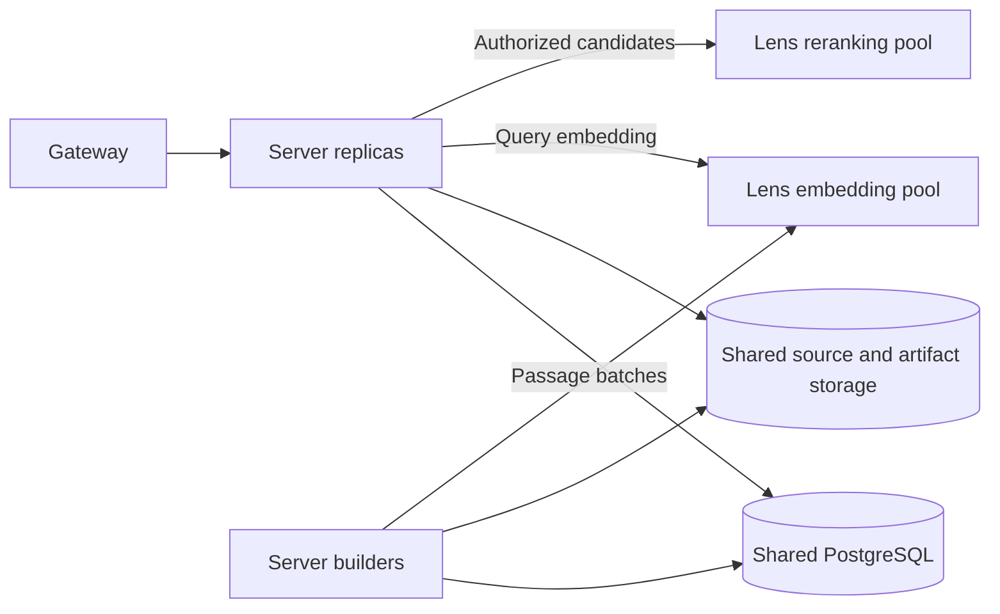

# Scaling Munarium Server and Lens

Server v1.4 already runs multiple API replicas and background builders against one PostgreSQL database. Upgrade Server to v1.5 to obtain the proposed admission, job coordination and fleet controls. The upgrade must keep existing clients, stored data and defaults usable during a rolling deployment. [Source baselines](README.md#source-baselines) · [v1.5 plan](README.md)

## How Server v1.4 scales

A gateway or Kubernetes Service distributes requests among ready Server replicas. Each process serves REST and gRPC with its own admission limits, connection pool, caches and process metrics. A replica authenticates the caller, resolves tenant and collection scope, and uses shared state to carry out the operation. A subsequent request for a persisted session can reach another replica. An open stream remains attached to the process that accepted it. [Cluster guide](../ops/clustering.md) · [Request handling](../../src/munarium-server/src/middleware.rs)

| Work | Shared across replicas | What an additional replica contributes |
|---|---|---|
| API reads, ledger writes and runbooks | PostgreSQL holds ledger heads, idempotency records, sessions, runbook checkpoints and index bindings. A lineage row lock orders writes to its head. A session-level advisory lock gives one executor ownership of a particular run. | Another request handler, pool and CPU budget. Independent requests can make progress in parallel. Writers on the same ledger head still serialize. A lost executor releases its lock, and a checkpointed run requires the documented recovery procedure. [Cluster guide](../ops/clustering.md) · [Runbook executor lock](../../src/munarium-server/src/runbooks_api.rs) |
| Sources and search | Replicas need the same source bytes through PostgreSQL, a supported object store or a shared filesystem. PostgreSQL serves the default retrieval path. With Datastore selected, the catalog and durable artifact store (L2) are shared. | Each Datastore reader hydrates a verified local disk cache (L1) and opens shards in process memory (L0). New readers consume object-store bandwidth and disk before they can serve their required scopes. Route traffic according to `/readyz`. [Datastore guide](../guides/datastore.md) · [Readiness warmer](../../src/munarium-server/src/datastore_serving.rs) |
| Durable index jobs | The PostgreSQL queue deduplicates open jobs by target and leases eligible rows using `FOR UPDATE SKIP LOCKED`. Claims and heartbeats are shared. Synchronous build routes still execute on the accepting replica. | Each process with `MUNARIUM_DATASTORE_BUILDER=enabled` starts a loop that claims and executes one queued job at a time. More builders can process independent jobs. Each needs staging capacity and access to the same sources, catalog and artifact store. [Builder loop](../../src/munarium-server/src/datastore_jobs.rs) · [Queue and leases](../../src/munarium-store-pg/src/jobs.rs) |
| Configuration, provider limits and audit | The database holds tenant configuration, durable budget reservations and persisted interaction records. Each process refreshes its registry caches on the configured interval. | Each replica has its own provider rate window, embedding cache and bounded interaction writer. Scrape each process. Dropped audit records and insert failures limit what aggregate reports can establish under load. [Rate windows](../../src/munarium-providers/src/lib.rs) · [Budget reservations](../../src/munarium-store-pg/src/budget.rs) · [Interaction writer](../../src/munarium-server/src/interactions.rs) |

For multiple Server processes, use distinct instance identities and shared storage. A `MUNARIUM_REPLICA_COUNT` above one makes startup refuse a memory ledger or memory source store and warn that a file source store requires a shared mount. The same setting divides each configured provider RPM and TPM limit. Each process receives `max(1, ceil(limit / replica_count))` per local minute window. For example, a limit of 5 with two processes allows 3 each, and a limit of 1 allows 1 each. An omitted RPM or TPM has no corresponding cap. A restart opens a fresh window. Durable daily reservations have separate accounting. [Server configuration](../../src/munarium-server/src/config.rs) · [Provider rate windows](../../src/munarium-providers/src/lib.rs)

The v1.4 chart requests two pods by default and omits `MUNARIUM_REPLICA_COUNT`, whose binary default is one. Both pods can therefore admit the full finite provider limit. At 60 RPM, two busy pods can admit 120 requests across their two local windows. The synthesized provider configuration has no RPM or TPM limit. The chart normally uses PostgreSQL for both ledger and source bytes, but an omitted count leaves the cluster startup checks inactive even with two pods. The chart supplies readiness and liveness probes. [Deployment template](../../deploy/helm/munarium/templates/deployment.yaml) · [Chart values](../../deploy/helm/munarium/values.yaml) · [Provider defaults](../../src/munarium-providers/src/lib.rs)

## Choose the Server resource to scale

| Symptom under a fixed, authorized workload | Diagnosis and next comparison |
|---|---|
| Foreground latency and overload refusals rise while the database and downstream services have spare capacity | Add a ready API replica at the same settings. Compare successful queries per second, p95 latency and refusals at the same offered load. Check REST and gRPC separately. Each has its own per-process permit pool, while both consume the same CPU and database capacity. |
| Build queue age grows while query targets still hold | Add a builder to a separately selected worker group using the existing binary. Compare queue age, completed and verified jobs per hour, database waits and staging disk. When extraction or object transfer saturates the shared path, additional workers can lengthen foreground latency. |
| Pool contention, slow SQL or one hot ledger head dominates | Budget the sum of all API and builder pool limits, concurrent runbook lock connections and migration/operational reserve against PostgreSQL capacity. Include old and new pods during rollout. Inspect the slow query or lock before adding pools. A wider fan-out can exhaust that same capacity. |
| Cold starts or simultaneous scale-up reduce the ready fleet | Measure time to hydrate selected artifacts and open them, L2 reads, local disk headroom and ready replicas by deployment revision. Stage replacements before draining healthy readers. Configure fleet expectations if promotion must depend on ready replicas with the candidate already open. |

Use successful, authorized operations as the throughput measure. A shed request, a queued job and a published index are distinct outcomes. Record corpus size, warm or cold cache state, per-turn fan-out, concurrent builds, errors and observed resource limits alongside rates. The existing two-instance cluster suite establishes selected coordination properties. A throughput claim needs measurements on the candidate deployment. [Performance guide](../guides/measuring-performance.md) · [Validation guide](../guides/validation.md)

## Backwards-compatible Server improvements for v1.5

**SC1.** Server v1.5 must allow an operator to add and remove ready Server replicas and Lens workers independently under load. Phase SCALE first qualifies Server with Lens disabled. It then qualifies the combined topology with enrolled collections. Existing clients, collections and index pins keep working throughout a resize. [Delivery phases](README.md#delivery-phases)

| Work package | Change and compatibility boundary | Acceptance receipt |
|---|---|---|
| SCALE-1 · Replica counts | Ship the production install profile and preserve legacy values on upgrade as described below. | **SCALE-1-T1.** Render fresh production values, an upgrade with the key omitted, an explicit integer, and an intentional mismatch. Upgrade twice and roll back. Check the effective count on every group, startup guards, total connections and aggregate admissions at steady state and during surge. With `platform-v1` enabled, verify startup refuses count 2 even with shared storage and that replacement of the single supported instance never overlaps its predecessor. |
| SCALE-2 · Serving and builder groups | Give operators independent replica counts. A builder-only group stays out of the gateway selector. Keep the existing single-group layout on omission. | **SCALE-2-T1.** Add and drain a builder with work in flight. Verify fencing and reclaim, continued foreground service and sufficient staging space. |
| SCALE-3 · Diagnostics | Expose ready and requested replicas, pool capacity, ready readers and builder queue age. Keep metric labels bounded and content-free. | **SCALE-3-T1.** Drive a known queue and pool bottleneck, then resize. Compare operator-visible counts, backlog and pressure with actual fleet and database observations. |

The new profile builds on control admission, durable jobs, shared console sessions and artifact protection. Keep v1.4 behavior during the mixed-version rollout until every relevant process can enforce the new guarantee. Hash-only installations can adopt these changes with Lens disabled. [Control reserve](airk-analysis.md#b3) · [Fair claiming](airk-analysis.md#b1) · [Console cutover](airk-analysis.md#login1) · [Artifact blocking](airk-analysis.md#art1)

### SCALE-3 replica membership

Implemented 20 November 2026 (migration 0090). Every Server process on the PostgreSQL store writes an expiring heartbeat at startup and every 15 seconds: a random per-process replica id, the instance id, build version, `MUNARIUM_DEPLOYMENT_PLANE`, its configured `MUNARIUM_REPLICA_COUNT` and its capabilities. A row expires 45 seconds after its last write by the database clock; expired rows are ignored and pruned. Heartbeats are scoped by `MUNARIUM_DEPLOYMENT_ENVIRONMENT_ID`. The memory store is single-replica by validation and reports itself. [Replica heartbeats](console-sessions.md#replica-heartbeats)

`GET /v1/reports/scale` sets `observed_replicas` to the live heartbeats beside the answering replica's `replica_count`, and `replica_membership` lists them with `exceeds_configured`. The console Health page shows the same as "live / configured" and warns when more replicas are live than configured, because each process then divides the provider limits too few ways. A failed or timed-out heartbeat read is `unavailable` with a null count, never 0 (the U5 rule). A v1.4 process writes no heartbeat and is not counted, so fewer live than configured is shown but is not a warning during a mixed-version rollout. The same heartbeats feed the [console cutover preflight](console-sessions.md#cutover). [REST reference](../api/rest.md)

### Helm installation, upgrade and rollback

The proposed v1.5 chart uses a persisted `providerReplicaCount` value. With `auto`, render the same `MUNARIUM_REPLICA_COUNT` on every Server group from the desired serving and separate builder counts. Count a process that both serves and builds once. A positive integer renders that fixed divisor. Omission leaves the environment entry absent on every render, so existing values and post-render overrides keep their effect. Use the same values file for installation, upgrade and declarative rendering. [Configuration compatibility](README.md#compat-t2)

| Operator action | Expected result and check |
|---|---|
| Install a fresh v1.5 production release using the supplied production values profile | The profile explicitly sets `providerReplicaCount: auto`. With two serving pods and no separate builders, verify both see 2. With a 60 RPM provider and an even load, each admits 30 in its fresh window. Adding a separate builder changes the steady-state divisor to 3 on all three processes. |
| Install or re-render the bare chart with the key omitted | This selects the legacy behavior even for a fresh install. Two default pods each see divisor 1 unless an external override supplies a count. The production installation instructions must include the profile explicitly and retain it on subsequent upgrades. |
| Upgrade an existing two-pod v1.4 release with its original values | With the key omitted, both processes retain their prior effective count, ordinarily 1. Confirm an externally supplied count also survives upgrade. Show the effective divisor beside the observed fleet count and warn when more live processes are observed than the divisor allows. Report unknown membership if the observation is unavailable. |
| Migrate that release to the production profile | Check shared stores, peak live callers, pool capacity and rollout surge. Replace any existing count override with the equivalent chart setting as one change. Save `providerReplicaCount: auto` in release values and roll the groups. Verify both pods become ready with count 2 and the expected 30 RPM share. A storage refusal requires correcting the storage configuration before continuing. |
| Migrate a `platform-v1` deployment | This profile requires one actual Server process and a configured count of 1. Keep one pod, zero separate builders and no rollout overlap. Stop the old process before starting its replacement. A divisor of 1 on a multi-pod deployment conceals the extra processes from the startup guard. [Platform startup requirements](../../src/munarium-server/src/state.rs) |
| Roll back | Restore the prior values, post-render overrides and chart revision together. The v1.4 chart ignores the new key. If divisor 2 is still required, carry it through the previous chart's deployment override. Otherwise restoring legacy defaults restores divisor 1 and the two full windows. Drain or limit provider work during the transition and verify effective counts and admissions before resuming traffic. |

**Automatic scaling qualification.** SC1 covers operator-controlled resize. A future autoscaling profile needs one controller per replica count and an explicit maximum for each group. To support a provider ceiling, either enforce it with a shared limiter or prove a conservative allocation. For each provider accounting interval, bound the sum of all local window allowances that can admit work in that interval. Include rounding, the one-unit minimum, windows already open, new windows after resets, incoming and draining pods, separate builders and rollout surge. Peak simultaneous pod count alone cannot bound replacements that arrive after a process spends its allowance. Exercise a small indivisible limit, uneven load, a restart after consumption, and scale-up and scale-down with calls in flight. If replacement rate is unbounded or the sum can exceed the ceiling, the static allocation cannot qualify. Keep Lens growth inside the authorized hardware and budget envelope.

## Scaling Server and Lens together

The following paths require v1.5. Consider a deployment that serves interactive searches while rebuilding an enrolled collection. During the build, a Server builder extracts and batches passages, asks Lens to embed them, then writes and verifies the candidate index. A query takes a different path. A serving Server replica checks the caller and collection policy, requests a query embedding, retrieves candidates from its approved index, then sends the authorized candidates to Lens for reranking. Server validates the returned order and resolves citations to the pinned sources. Both paths use the collection's tenant-owned inference budget. An unenrolled v1.4 collection continues through native retrieval on the upgraded Server. [Inference design](airk-analysis.md#86-the-seam-an-inference-endpoint-behind-the-provider-gateway)

Embedding and reranking can share a worker in a small installation. In a larger one, Server can use the same logical endpoint while its operator routes each stage to ready workers for the exact approved profile. Adding a matching worker lets independent requests or batches execute in parallel. It requires neither a client change nor rebuilding an index. A new embedding model or preprocessing profile changes vector compatibility and requires a separately built, verified index. A reranker change needs separate quality qualification and policy approval. [Lens replication and operations](repository-handoffs.md#independent-lens-replicas)

Worker placement during scale-out, drain and failure must follow the [SC2 shared and dedicated pool policy](repository-handoffs.md#sc2).

| What the operator observes | First capacity change to test | How to tell whether it helped |
|---|---|---|
| Builders and live queries are waiting for embeddings | Add a matching Lens embedding worker. Bound bulk batches and queue wait so a large rebuild leaves capacity for foreground queries. | Higher verified build throughput with the query latency target still met. Compare queue wait with actual inference time. |
| Candidates are retrieved promptly but spend most of the query deadline waiting for reranking | Add a matching reranking worker. Hold candidate count and retrieval settings fixed. | Shorter rerank queue and more completed, cited queries per second, with both corpus families meeting I3. |
| PostgreSQL lock or I/O wait, artifact hydration, an external provider limit, or the tenant's budget is binding | Address the measured constraint before increasing either fleet. | Improved throughput or fewer refusals without exceeding the same connection, cost and policy limits. |

### Recommended v1.5 changes at the inference boundary

1. **Make identical workers interchangeable.** Bind prepared vectors, probe results, indexes and routing to the approved semantic profile. Include model/tokenizer revision, dimensions, precision, instructions and normalization as applicable. A new worker proves readiness for that profile before entering rotation. A worker address may change under a stable service URL. Keep the prior profile addressable for pinned reads. Partition operations by compatible model, authorization and payer when a query spans collections. [Embedding cache](../../src/munarium-server/src/providers_api.rs) · [Retrieval merge](../../src/munarium-retrieval/src/merge.rs)
2. **Validate batch identity before writing any vectors.** The existing OpenAI adapter reads embeddings in returned array order. For the new enrolled profile, require one valid result index per submitted input, restore input order, and check every vector's dimension and finite coordinates. An invalid batch fails before it can populate a cache or index. Test a reversed valid response and a response with a duplicate index. A successful query must still cite the correct original file. [Existing embeddings adapter](../../src/munarium-providers/src/lib.rs)
3. **Keep budgets and deadlines independent of fleet size.** Use a shared, durable collection-budget reservation for each dispatched inference attempt, including retries. Preserve caller attribution and separate shadow metering under I2. Include queueing in the same deadline, bound batches by input size as well as count, and disable transparent load-balancer replays. Reconcile a timeout or lost response by attempt ID, retaining unknown usage when the backend cannot establish it. Adding a worker grants no additional tenant spending authority. The existing process-local share of a provider rate limit and the durable daily token accounting have different purposes. [Cluster rate limits](../ops/clustering.md) · [Token accounting](../tokenbudgets.md)
4. **Expose enough information to size each pool.** Add content-free measurements for queue wait, inference time, admitted/completed/refused work, batch tokens, worker readiness and device memory per stage. Pair these with Server admission, database and hydration measurements. Keep query text, paths and tenant or user identifiers out of metric labels. For an optional autoscaler, use sustained queue age and throughput with device headroom, bounded replica counts, warm-up and scale-down stabilization. For Server, budget for the database connections of the peak fleet during rollout. Start with a tested fixed-size deployment. [Performance measurements](../guides/measuring-performance.md)

## Qualification and rollback

Run these checks under sustained authorized traffic in the [recorded qualification environments](README.md#qualification-environments).

| ID | Required transition | Pass condition |
|---|---|---|
| **SC1-T1** | With Lens disabled, resize Server from one ready replica to two and back to one. Replay v1.4 clients during the transition. | Both replicas serve after scale-up. The retiring replica stops admitting new work, drains and leaves the survivor serving correct results. |
| **SC1-T2** | Enable the qualified Lens profile. Vary Server with Lens held steady, then vary embedding and reranking workers separately with Server held steady. | Each transition shows requested and ready counts, observed work on both members, in-flight outcomes, query latency, refusals and budget reconciliation. Serving pins and citations survive the drain. |
| **SC1-T3** | Replace a worker mid-request, try an incompatible profile, then remove the last ready member of a stage and restore capacity. | The configured I1 outcome, I2 accounting and SC2 placement hold through failure and recovery. Restore the prior serving policy and replay the baseline. |

Use the same run to collect the separate [SC2 isolation and placement receipts](repository-handoffs.md#sc2). Capture evidence per ID even when the tests share infrastructure.

For MCP, A6 adds a durable audit write to every tool invocation. Include that write in the load test and measure its effect on database connections and query latency when adding Server replicas. Interrupt the admission write on one replica and verify that the refused call produces no Lens traffic. Check from another replica that any committed admission record survives the first replica's restart. [MCP audit design](mcp-analysis.md#73-audit-and-metrics)

- **Establish the upgrade baseline.** Run released v1.4 clients against v1.4 Server, then against the upgraded v1.5 fleet with Lens disabled. Compare permitted results, refusal behavior, citations, index identities and external calls. Keep new policies inactive while a serving replica or eligible builder still lacks support. After the last relevant process upgrades, enable one change at a time.
- **Locate the limiting tier.** On the same pinned corpus and hardware class, compare one Server/one Lens worker, two Servers/one Lens worker, one Server/two Lens workers and two Servers/two Lens workers. When the stages have separate pools, vary one stage at a time. Hold builder count, budget, candidate depth and workload mix fixed, then vary builder count in a separate run. Compare cold and warm runs at the same offered load and increase load to find sustainable throughput under predeclared limits. Report verified queries/s, verified builds/hour, p95/p99 latency, queue age, refusals, DB connections and cost. A capacity claim needs comparable results for the exact topology. [Measurement procedure](../guides/measuring-performance.md)
- **Supporting load case.** Direct a session through different Server replicas and stage calls through different Lens workers. Replace one worker mid-build and mid-query, try a worker with a mismatched profile, then take an entire stage out of rotation. Check bounded admission, fresh authorization, pinned citations, I1 refusal or explicitly approved fallback, and I2 reservations across retries. Race two callers for one remaining reservation. Verify ordinary native traffic, including v1.4 clients, and keep B3's authenticated control reserve usable.
- **Restore serving and prove coverage.** Scale back to the qualified fixed counts, drain in-flight work and retain the prior model pool until its pins can be retired. Restore each enrolled collection's earlier approved index and serving policy, then replay baseline queries and resolve their citations. A binary rollback to v1.4 uses the roadmap's pre-activation boundary. Run the LENS-D2 workspace build, query, citation and rollback exercise on the exact supported topology across all 16 workspace repositories, and retain separate I3 quality and latency outcomes for documentation and code. [Release and rollback plan](README.md) · [Workspace qualification](repository-handoffs.md#workspace-build-query-citation-and-rollback)
